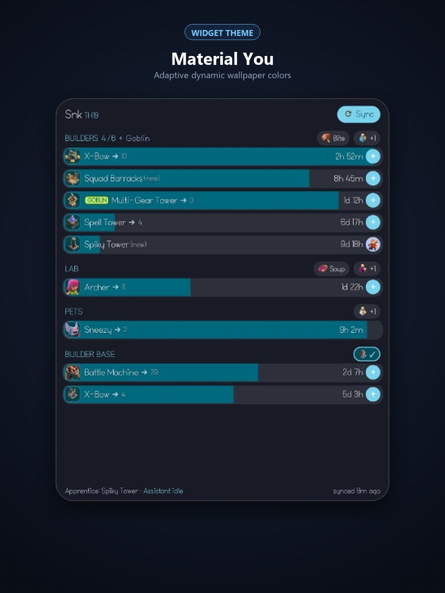
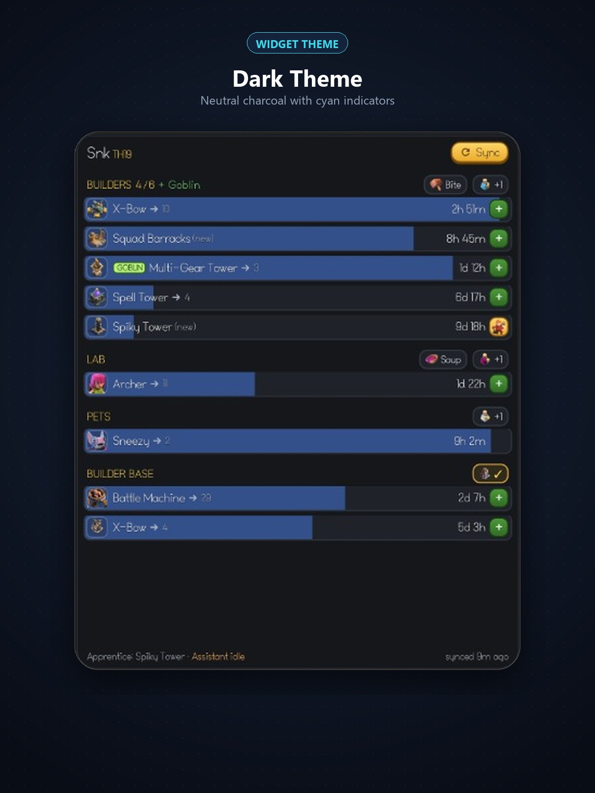

<p align="center">
  
</p>

<h1 align="center">Chief Timer</h1>

<p align="center">
  <b>The ultimate offline companion widget and upgrade countdown tracker for Clash of Clans.</b><br>
  <i>O assistente definitivo, seguro e 100% offline para rastrear suas construções e pesquisas no Clash of Clans.</i>
</p>

<div align="center">

[](https://github.com/Snk-B/Chief-Timer/releases/latest)
[](https://developer.android.com)
[](#-privacy--security)
[](#-key-features)
[](#-customizable-widget-themes)
[](LICENSE)

</div>

---

## 🌟 Overview / Visão Geral

**Chief Timer** is a modern, high-precision Android app and home-screen widget designed for **Clash of Clans** players. It provides real-time, second-by-second countdowns for all your ongoing upgrades across both your **Home Village** and **Builder Base 2.0**, factoring in potions, snacks, events, the Builder's Apprentice, and the Lab Assistant.

Designed with **Material 3 Expressive**, authentic Clash typography, dynamic Material You theming, and an ultra-deep **Pitch Black AMOLED** theme, Chief Timer gives you complete control over your village progression right from your home screen.

> 🔒 **100% Private & Fully Offline**: Chief Timer does not request the `INTERNET` permission (`android.permission.INTERNET`). Your village data is never transmitted, uploaded, or shared. Everything stays strictly on your device.

---

## ✨ Key Features / Principais Recursos

### 🏰 Full Town Hall 19 & Builder Base Coverage
- **Home Village**: Tracks all standard Builders (up to 6), the event Goblin Builder, the Laboratory, and the Pet House.
- **Town Hall 19 Ready**: Full asset, level, and timer support for TH19 defenses, heroes, and buildings.
- **Builder Base 2.0**: Accurate tracking for B.O.B / O.T.T.O, Master Builder, and the Star Laboratory.
- **Level-Specific Art**: Displays high-resolution building, trap, troop, and hero artwork matching the target upgrade level.

### ⏱️ Live Home Screen Widgets
- **Live Countdowns**: Real-time ticking timers on your home screen with zero background battery drain using Android exact alarms.
- **Three Layout Styles**:
  - **List Style**: Clean row layout with animated progress bars and finish times.
  - **Grid Style**: Compact circular progress rings with high-res building badges.
  - **Minimal Style**: Nothing-inspired monochrome dot-matrix aesthetic with clean accent indicators.
- **Scrollable & Scalable**: Scales smoothly from compact 2×2 widgets to full-screen layouts.

### 🎨 Customizable Themes
Choose the perfect look for your home screen setup:
- **Material You Dynamic**: Harmonizes automatically with your Android wallpaper colors (Android 12+).
- **Pitch Black (AMOLED)**: Pure deep `#000000` background engineered for modern OLED/AMOLED screens.
- **Clash Theme**: Authentic Supercell wood-and-stone aesthetic.
- **Dark Theme**: Neutral dark palette with cyan progress indicators.
- **Light Theme**: Clean, minimalist white design.

<p align="center">
  
  
  
  
</p>

### ⚡ Boost, Snack & Event Simulation Engine
- **Stacking Potions & Snacks**: Simulates 10× Builder Potions, 2× Builder Bites, 2× Study Soup, Research Potions, and Pet Potions with consecutive stacking rules.
- **Builder Base Clock Tower**: Precise 10× speed boosts calibrated to verified Clock Tower levels (14 min to 32 min), complete with boost and cooldown timers.
- **Apprentice & Lab Assistant**: Assign the Builder's Apprentice or Laboratory Assistant with a single tap to adjust predicted finish dates instantly.
- **Deterministic Segment Engine**: Avoids floating-point calculation drift, guaranteeing exact completion times.

### 🌐 Multi-Language Support
Seamless multilingual interface supporting:
- 🇧🇷 **Português (Brasil)**
- 🇺🇸 **English**
- 🇷🇺 **Русский**

### 👥 Multi-Account Support
- Effortlessly manage multiple accounts.
- Assign dedicated widgets to different accounts side-by-side on your home screen.

---

## 🚀 How to Use / Como Usar

### 1. Export Village Data from Clash of Clans
1. Open **Clash of Clans**.
2. Tap your **Town Hall** (or Builder Hall) icon in the top-left corner.
3. Go to **Settings** ⚙️ ➔ **More Settings**.
4. Scroll to the bottom and tap **Export Village JSON** (or *Exportar dados da vila*). The JSON is automatically copied to your clipboard.

### 2. Sync with Chief Timer
- Open **Chief Timer** and tap **Sync from clipboard** (or enable *Auto-sync on open* in Settings).
- Alternatively, tap the **Sync** button directly on your home-screen widget!

### 3. Place the Widget
- Long-press any empty area on your home screen.
- Select **Widgets** ➔ **Chief Timer**.
- Choose your preferred style (List, Grid, or Minimal) and color theme, then place it!

---

## 📱 Screenshots

<p align="center">
  
  
</p>

<p align="center">
  
</p>

---

## 📥 Download / Baixar APK

The latest ready-to-install APK can be downloaded directly from the **Releases** page:

👉 **[Download ChiefTimer.apk (v1.0.0)](https://github.com/Snk-B/Chief-Timer/releases/latest)**

1. Download the `.apk` file directly to your Android device.
2. Tap the file in your notification bar or Downloads folder to install.
3. Enjoy your offline Clash of Clans companion widget!

---

## 🛠️ Building from Source

### Prerequisites
- **JDK 17** or newer
- **Android SDK** (API 35, Android 15/16/17 build tools)

### Build Debug APK
```bash
git clone https://github.com/SnK-B/Chief-Timer.git
cd Chief-Timer
./gradlew assembleDebug
```
The resulting APK will be generated at:
`app/build/outputs/apk/debug/app-debug.apk`

### Run Unit Tests
```bash
./gradlew testDebugUnitTest
```

---

## 🔒 Privacy & Security

Chief Timer is strictly offline:
- **No Internet Permission**: `android.permission.INTERNET` is not included in the application manifest.
- **Local Storage Only**: Your village layout and upgrade timers are saved exclusively in your device's private app sandbox (`DataStore` / `Room`).
- **No Trackers or Analytics**: No ads, no third-party SDKs, no telemetries.

---

## 📜 Disclaimer & License

### Disclaimer
This application is an unofficial fan project and is not affiliated with, endorsed, sponsored, or specifically approved by Supercell. Supercell is not responsible for the operation or content of this application. For more information regarding Supercell's policies, please visit [Supercell's Fan Content Policy](https://supercell.com/en/fan-content-policy/).

### License
Distributed under the **MIT License**. See [LICENSE](LICENSE) for more details.
