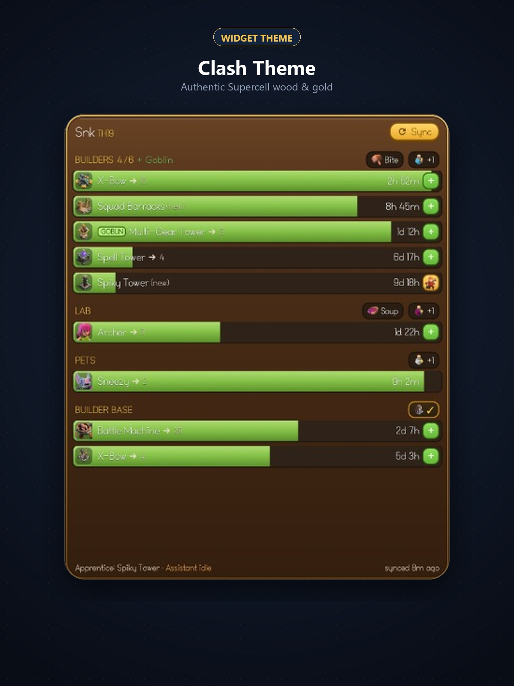
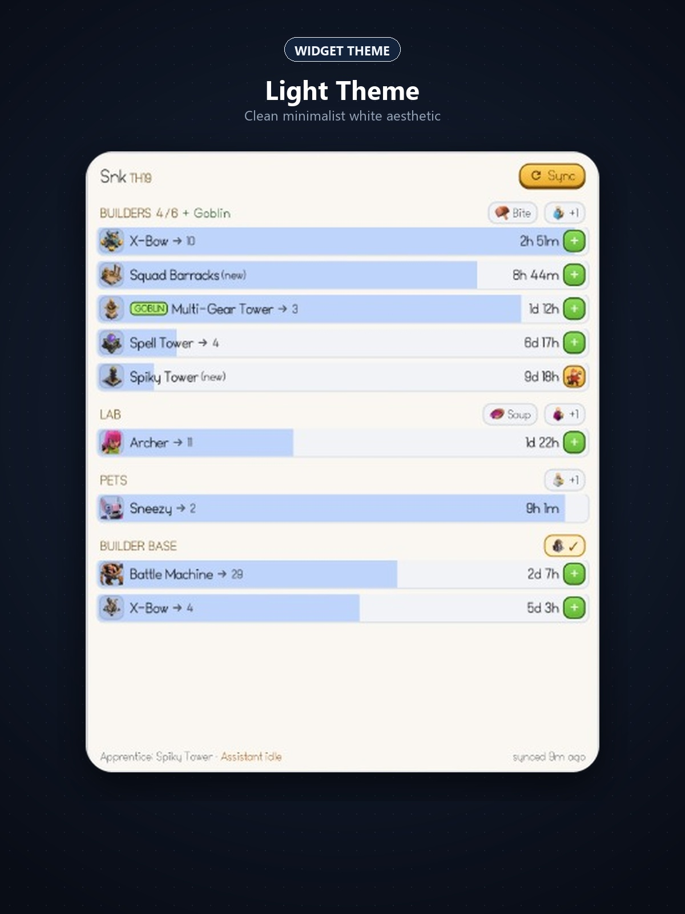

<p align="center">
  
</p>

<h1 align="center">Chief Timer</h1>

<p align="center">
  <b>The ultimate offline companion widget and upgrade countdown tracker for Clash of Clans.</b><br>
  <i>O assistente definitivo, seguro e 100% offline para rastrear suas construções e pesquisas no Clash of Clans.</i>
</p>

<div align="center">

[](https://github.com/Snk-B/Chief-Timer/releases/latest)
[](https://developer.android.com)
[](#-privacy--security)
[](#-highlights)
[](#widget-themes)
[](LICENSE)

</div>

A modern, offline Android application and home-screen widget for **Clash of Clans** that tracks your Home Village and Builder Base upgrade countdowns, potions, and special events in real time.

Designed with **Material 3 Expressive**, authentic Clash typography, an advanced boost calculation engine, dynamic Material You theming, and an ultra-deep **Pitch Black AMOLED** theme.

> 🔒 **100% Private & Fully Offline**: Chief Timer does not request the `INTERNET` permission (`android.permission.INTERNET`). Your village data is never transmitted, uploaded, or shared. Everything stays strictly on your device.

---

## Screenshots

<p align="center">
  
</p>

---

## Widget Themes

Five colour themes, chosen per widget: **Material You** (follows your phone's wallpaper colours), **Clash** (the authentic wood panel and green bars), **Dark** (neutral dark with a cyan bar), **Material pitch dark** (Material You colours on a true black AMOLED panel), and **Light** (clean white with a pale blue bar). Each theme has its own progress-bar colour, so text stays readable on every one.

<p align="center">
  
  
  
  
</p>

### List Widget

<p align="center">
  
</p>

---

### Grid Widget

<p align="center">
  
</p>

---

## Highlights

### 🎨 Material 3 Expressive Interface
- **Timers Dashboard**: Unified view of all ongoing upgrades with expressive cards, category chips, and animated `LinearWavyProgressIndicator` bars.
- **Authentic Typography**: Built with the bundled **Lilita One** Clash font for headings, numbers, and badges, paired with clean, legible tabular system typography for body text.
- **Completion Time on Every Card**: Each running timer shows a highlighted chip with the exact date and time it finishes, calculated from the same finish time as the countdown (boosts, potions, and helpers included).
- **Collapsible Filter Chips**: Filter chips smoothly collapse when scrolling and reappear when scrolling back to the top.
- **Dynamic Theming**: Full support for Material You dynamic color extraction (Android 12+) with expressive light and dark palettes.

### 🏛️ Complete Village Coverage (TH19 Ready)
- **Home Village**: Tracks all standard Builders (up to 6), the event Goblin Builder, the Laboratory, and the Pet House simultaneously.
- **Town Hall 19 (TH19)**: Full support for all TH19 defenses, heroes, troops, and buildings.
- **Builder Base 2.0**: Accurate tracking for B.O.B / O.T.T.O, Master Builder, and the Star Laboratory.
- **Level-Specific HD Artwork**: Displays high-resolution building, trap, troop, and hero artwork matching the target upgrade level.

### ⚡ Advanced Boost & Event Simulation Engine
- **Stacking Potions & Snacks**: Simulates 10× Builder Potions, 2× Builder Bites, 2× Study Soup, Research Potions, and Pet Potions with consecutive stacking rules.
- **Builder Base Clock Tower**: Precise 10× speed boosts calibrated to verified Clock Tower levels (14 min to 32 min), complete with boost and cooldown timers.
- **Apprentice & Lab Assistant**: Assign the Builder's Apprentice or Laboratory Assistant with a single tap to adjust predicted finish dates instantly.
- **Deterministic Segment Engine**: Avoids floating-point calculation drift, guaranteeing exact completion times.

### 🌍 Multi-Language Support
Seamless multilingual interface supporting:
- 🇧🇷 **Português (Brasil)**: 100% traduzido nativamente (interface, diálogos e notificações).
- 🇺🇸 **English**: Full native English interface.
- 🇷🇺 **Русский**: Full Russian localization.

### 👥 Multi-Account Support
- Effortlessly manage multiple accounts.
- Assign dedicated widgets to different accounts side-by-side on your home screen.

### 🔔 Notifications
- **Finish Alerts**: Notification when a builder, lab, or pet is free, complete with the Clash of Clans finish sound.
- **Clock Tower Ready Alert**: Notification when the exported Clock Tower cooldown ends.
- **Follow Do Not Disturb**: Compatible with system Do Not Disturb settings.

---

## 🚀 Quick Setup / Como Usar

### 1. Export Village Data from Clash of Clans / Exportar Dados do Jogo
1. Open **Clash of Clans**.
2. Tap your **Town Hall** (or Builder Hall) icon in the top-left corner.
3. Open **Settings** ⚙️ ➔ **More Settings** (*Mais Configurações*).
4. Scroll to the bottom and tap **Export Village JSON** (*Exportar dados da vila*). The village data is automatically copied to your clipboard.

### 2. Sync with Chief Timer / Sincronizar com o Chief Timer
- Open **Chief Timer** and tap **Sync from clipboard** (or enable *Auto-sync on open* in Settings).
- *Alternatively*: Tap the **Sync** button directly on your home-screen widget!

### 3. Place Your Widget / Adicionar o Widget na Tela Inicial
1. Long-press any empty area on your Android home screen.
2. Select **Widgets** ➔ **Chief Timer**.
3. Choose your preferred layout (**List** or **Grid**) and theme, then place it!

---

## 📥 Download / Baixar APK

The latest ready-to-install APK can be downloaded directly from the official **Releases** page:

<div align="center">

### 👉 **[Download ChiefTimer.apk (v1.0.2)](https://github.com/Snk-B/Chief-Timer/releases/latest)** 👈

</div>

1. Download the `.apk` file directly to your Android device.
2. Tap the file in your notification bar or Downloads folder to install.
3. Open **Chief Timer**, sync your village, and enjoy your offline companion widget!

---

## 🛠️ Building from Source

### Prerequisites
- **JDK 17** or newer
- **Android SDK** (API 35, Android 15/16/17 build tools)

### Build Debug APK
```bash
git clone https://github.com/SnK-B/Chief-Timer.git
cd Chief-Timer
./gradlew assembleDebug
```
The resulting APK will be generated at:
`app/build/outputs/apk/debug/app-debug.apk`

### Run Unit Tests
```bash
./gradlew testDebugUnitTest
```

---

## 🔒 Privacy & Security

Chief Timer respects your privacy unconditionally:
- **Zero Network Access**: The app manifest does not request `android.permission.INTERNET`. It is technically impossible for the app to send data over the network.
- **Local Storage Only**: Your village layout and upgrade timers are saved exclusively in your device's private app sandbox (`DataStore` / `Room`).
- **No Trackers or Analytics**: No ads, no third-party SDKs, no telemetries.

---

## 📜 Disclaimer & License

### Disclaimer
This application is an unofficial fan project and is not affiliated with, endorsed, sponsored, or specifically approved by Supercell. Supercell is not responsible for the operation or content of this application. For more information regarding Supercell's policies, please visit [Supercell's Fan Content Policy](https://supercell.com/en/fan-content-policy/).

### License
Distributed under the **MIT License**. See [LICENSE](LICENSE) for more details.
