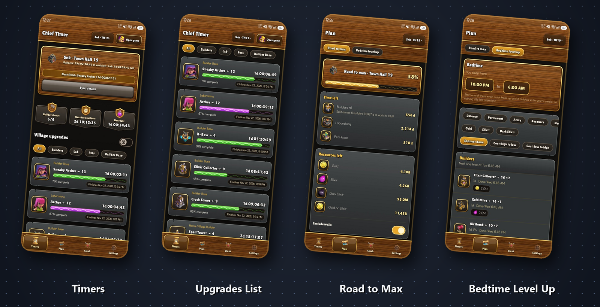
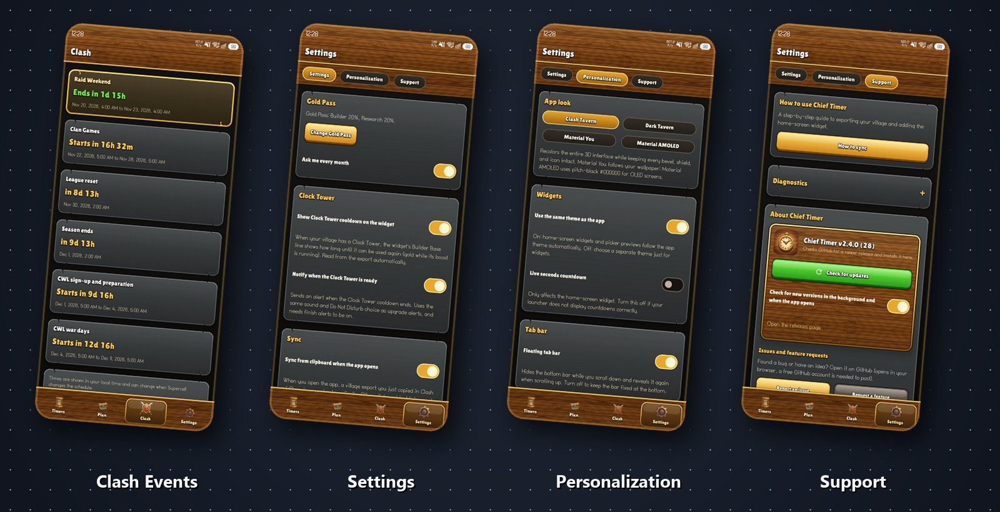
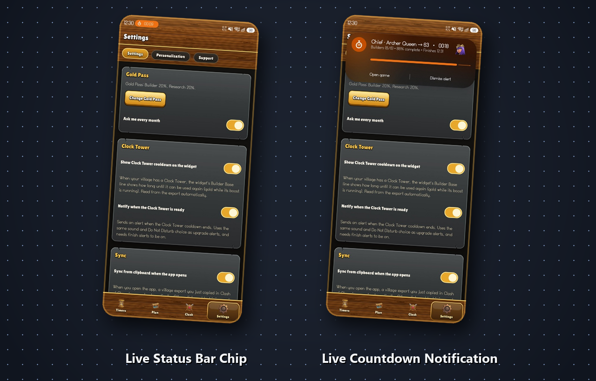
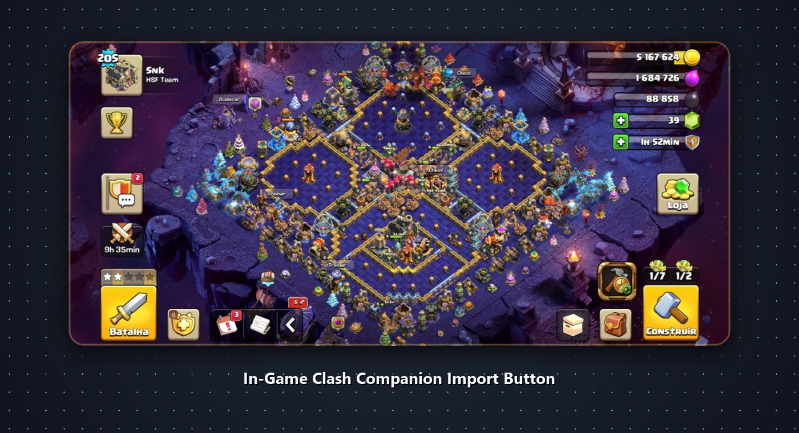
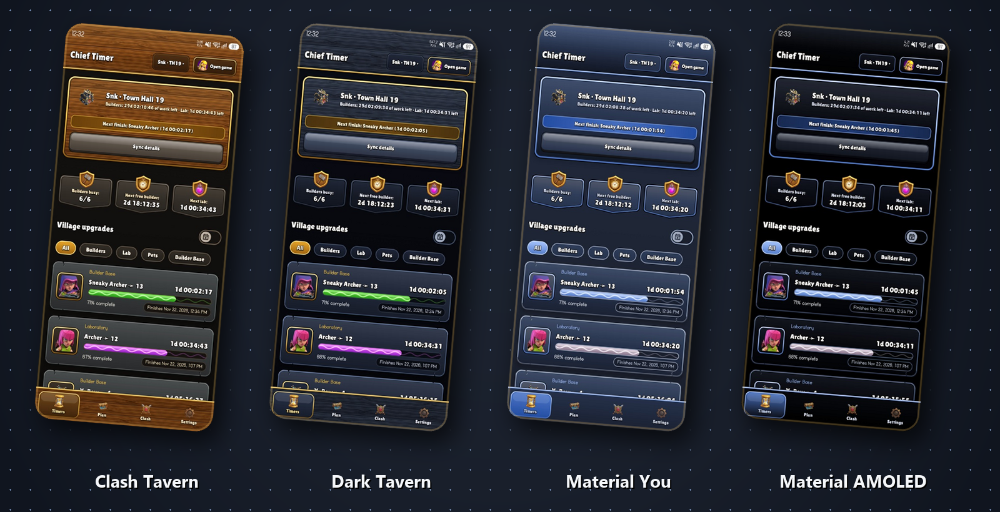
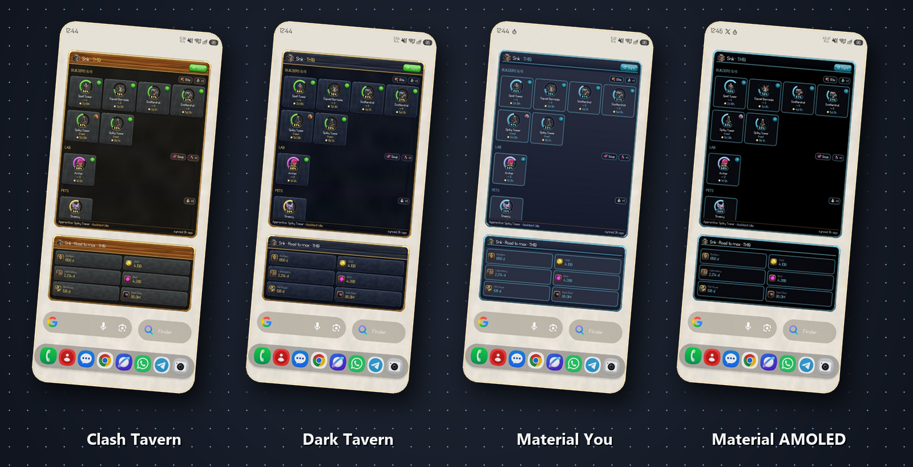

<p align="center">
  
</p>

<h1 align="center">Chief Timer</h1>

<p align="center">
  <b>3D Clash-style companion app, live countdown widgets, and Android 16+ Live Notifications for Clash of Clans.</b><br>
  <i>O assistente 3D definitivo para acompanhar construtores, laboratório, pets e eventos no Clash of Clans — direto na tela inicial e na barra de status.</i>
</p>

<div align="center">

[](https://github.com/Snk-B/Chief-Timer/releases/latest)
[](https://developer.android.com)
[](#-highlights)
[](#-live-notifications--samsung-now-bar)
[](#-themes-app--widgets)
[](LICENSE)

</div>

---

**Chief Timer** is an open-source Android companion and home-screen widget suite for **Clash of Clans** covering **Home Village (up to TH19)** and **Builder Base 2.0**. Built with a custom **3D Tavern & Chiseled Stone UI**, animated wavy progress bars, an optional **in-game floating import button**, **Android 16+ Live Notifications / Samsung Now Bar**, and full **Material You** & **Material AMOLED** theming.

> 🔒 **Local-First Privacy**: Your village exports, player tags, and upgrade timers never leave your device. Network access is used strictly to fetch game data/HD icons from ClashKing, live Clash event schedules, and optional GitHub app update checks.

---

## ✨ App Overview

<p align="center">
  
</p>

<p align="center">
  
</p>

---

## 🔥 What Sets Chief Timer Apart

### 🔔 Live Notifications & Samsung Now Bar
Never miss an upgrade finishing in the final stretch. On **Android 16+ / One UI**, Chief Timer promotes an interactive **Live Update** chip directly into the status bar and lock screen / Now Bar during the final minutes of an upgrade, complete with a real-time countdown, progress bar, **Open game**, and **Dismiss alert** actions.

<p align="center">
  
</p>

---

### 🎮 In-Game Clash Companion Button
Optionally enable **Clash Companion** (or toggle it from Android Quick Settings) to show a compact floating **Hammer + Clock** button right inside Clash of Clans — letting you export your village JSON and sync Chief Timer with a single tap without leaving the game.

<p align="center">
  
</p>

---

## 🎨 Themes (App & Widgets)

Customize the app and every home-screen widget independently across **4 distinct 3D palettes**:
- **Clash Tavern**: Carved oak wood planks, 360° chiseled slate-stone plaques, golden bezels, and emerald/elixir/gold accents.
- **Dark Tavern**: Charred ebony/charcoal wood planks paired with deep obsidian-slate plaques.
- **Material You**: Dynamic colors extracted from your Android wallpaper (Android 12+).
- **Material AMOLED**: Pitch-black `#000000` background with crisp dynamic neon accents for OLED screens.

### App Themes
<p align="center">
  
</p>

### Home-Screen Widgets (Grid, List, Minimal & Road to Max)
<p align="center">
  
</p>

---

## 🌟 Highlights

- **🏛️ Complete Village Coverage (TH19 Ready)**: Simultaneously tracks all Home Village Builders (up to 6 + Goblin Builder), Laboratory, Pet House, and Builder Base 2.0 (Master Builder, B.O.B, Star Laboratory) with level-specific HD artwork.
- **⚡ Deterministic Boost & Helper Engine**: Simulates stacking **Builder Potions (10×)**, **Builder Bites (2×)**, **Study Soup (2×)**, Research/Pet Potions, **Builder Base Clock Tower** cooldowns, and one-tap **Builder's Apprentice / Lab Assistant** assignment without calculation drift.
- **🗺️ Smart Plan Tab**:
  - **Road to Max**: Estimates remaining builder/lab/pet days and total Gold, Elixir, Dark Elixir, and Wall costs — with an **Include walls** toggle that dynamically updates overall Town Hall completion.
  - **Bedtime Level Up**: Recommends upgrades that fit cleanly around your sleep window so builders never sit idle overnight.
- **📅 Live Clash Events**: Tracks Raid Weekend, Clan Games, League Reset, Season End, and CWL sign-up/war schedules in your local time zone.
- **👥 Multi-Account & Per-Widget Customization**: Manage multiple accounts and place dedicated List, Grid, Minimal, or Road to Max widgets side-by-side.
- **🌍 Native Localization**: 🇧🇷 **Português (Brasil)** · 🇺🇸 **English** · 🇮🇳 **हिन्दी** · 🇷🇺 **Русский**.

---

## 🚀 Quick Setup / Como Usar

1. **Export Village Data**: Open **Clash of Clans** ➔ **Settings** ⚙️ ➔ **More Settings** ➔ tap **Export Village JSON** (copies to clipboard).
2. **Sync**: Open **Chief Timer** (auto-syncs on open if enabled) — or tap **Sync** on your widget, or use the floating **Clash Companion** button inside the game.
3. **Add Widgets**: Long-press your home screen ➔ **Widgets** ➔ **Chief Timer** ➔ pick **List**, **Grid**, **Minimal**, or **Road to Max** and choose your theme.

---

## 📥 Download

Download the latest APK from the **[Releases](https://github.com/Snk-B/Chief-Timer/releases/latest)** page:

<div align="center">

### 👉 **[Download ChiefTimer.apk (v2.4.0)](https://github.com/Snk-B/Chief-Timer/releases/latest)** 👈

</div>

---

## 🛠️ Building from Source

### Prerequisites
- **JDK 17** or newer
- **Android SDK** (compileSdk 36 / Android 15–17 build tools)

```bash
git clone https://github.com/Snk-B/Chief-Timer.git
cd Chief-Timer
./gradlew assembleDebug
```

Run the unit test suite (`284` tests):
```bash
./gradlew testDebugUnitTest
```

---

## 🔒 Privacy & Permissions

- **Village Data Stays Local**: Your village exports, player tags, and timers are stored strictly on-device (`DataStore` / `SharedPreferences`). Nothing personal is ever uploaded.
- **Network Usage (`INTERNET`)**: Used exclusively to download updated ClashKing unit/building artwork & game data, synchronize live Clash event dates, and check GitHub Releases for app updates.
- **Optional Permissions**: `SYSTEM_ALERT_WINDOW` / `PACKAGE_USAGE_STATS` are optional and used only if you enable the in-game Clash Companion floating button; `POST_PROMOTED_NOTIFICATIONS` powers Android 16+ Live Notifications.

---

## 🙏 Credits & Acknowledgements

**Chief Timer** builds upon the open-source foundations created by:
- **[Kuswaa/clash-timers](https://github.com/Kuswaa/clash-timers)** — Original creator of Clash Timers, the core deterministic countdown/boost engine, and the home-screen widget architecture.
- **[Hy4ri/clash-timers (`feat/material-app-ui`)](https://github.com/Hy4ri/clash-timers/tree/feat/material-app-ui)** — Material 3 / Material You UI foundation.

---

## 📜 Disclaimer & License

This application is an unofficial fan project and is not affiliated with, endorsed, sponsored, or specifically approved by Supercell. For more information, see [Supercell's Fan Content Policy](https://supercell.com/en/fan-content-policy/).

Distributed under the **MIT License**. See [LICENSE](LICENSE) for more details.
