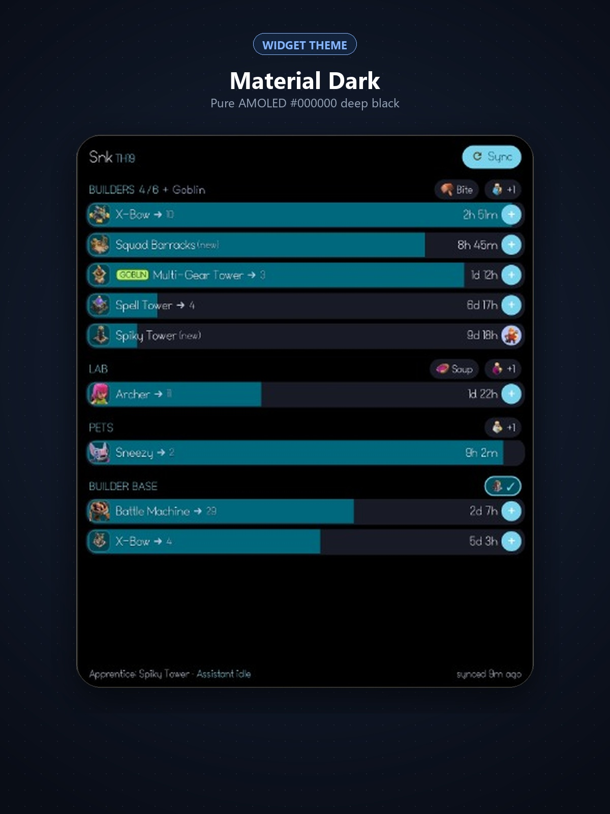
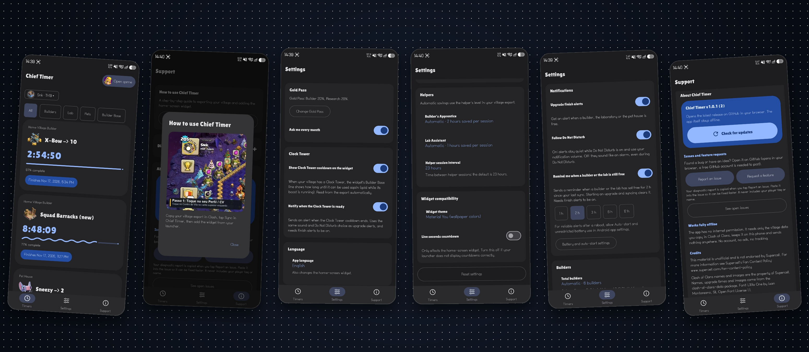

<p align="center">
  
</p>

<h1 align="center">Chief Timer</h1>

<p align="center">
  <b>The ultimate offline companion widget and upgrade countdown tracker for Clash of Clans.</b><br>
  <i>O assistente definitivo, seguro e 100% offline para rastrear suas construções e pesquisas no Clash of Clans.</i>
</p>

<div align="center">

[](https://github.com/Snk-B/Chief-Timer/releases/latest)
[](https://developer.android.com)
[](#-privacy--security--privacidade)
[](#-key-features--recursos-principais)
[](#-customizable-widget-themes--temas-personalizados)
[](LICENSE)

</div>

---

## 🌟 Overview / Visão Geral

**Chief Timer** is a modern, high-precision Android application and live home-screen widget engineered specifically for **Clash of Clans** chiefs. It provides second-by-second countdowns for all ongoing upgrades across both your **Home Village** and **Builder Base 2.0**, factoring in stacked potions, snacks, the Builder's Apprentice, the Laboratory Assistant, and ongoing events.

Designed from the ground up using **Material 3 Expressive**, authentic Clash typography, dynamic **Material You** theming, and an ultra-deep **Pitch Black AMOLED** theme, Chief Timer keeps your village progression visible at a glance right on your home screen.

> [!NOTE]
> 🔒 **100% Private & Fully Offline / 100% Privado e Offline**  
> Chief Timer does not request the `INTERNET` permission (`android.permission.INTERNET`). Your village data is never transmitted, uploaded, or shared. Everything stays strictly on your device.

---

## ✨ Key Features / Recursos Principais

### 🏰 Full Town Hall 19 & Builder Base 2.0 Coverage
* **Home Village Tracking**: Monitors all standard Builders (up to 6), the event Goblin Builder, the Laboratory, and the Pet House simultaneously.
* **Town Hall 19 (TH19) Ready**: Full asset, level, and timer support for all TH19 defenses, heroes, troops, and buildings.
* **Builder Base 2.0**: Accurate tracking for B.O.B / O.T.T.O, Master Builder, and the Star Laboratory.
* **Level-Specific HD Artwork**: Displays authentic high-resolution building, trap, troop, and hero graphics matching the exact target upgrade level.

### ⏱️ Live Home Screen Widgets
* **Real-Time Ticking Countdowns**: Live second-by-second timers on your home screen with zero background battery drain using native Android exact alarms.
* **Two Dynamic Layout Styles**:
  * **List Style**: Clean row layout with animated progress bars, finish times, and builder status.
  * **Grid Style**: Compact circular progress rings with high-res building badges and finish indicators.
* **Fully Resizable**: Scales smoothly from compact 2×2 widgets to full-page dashboard layouts.

---

## 🎨 Customizable Widget Themes / Temas Personalizados

Customize your widgets to perfectly harmonize with your home screen setup:

| Theme / Tema | Description / Descrição | Highlights / Destaques |
| :--- | :--- | :--- |
| **Material You** | Dynamic palette extracted from your wallpaper | Android 12+ Monet engine integration |
| **Clash Theme** | Authentic Supercell wood, stone and gold style | Classic Clash of Clans game aesthetic |
| **Dark Theme** | Neutral dark charcoal with cyan progress indicators | Modern high-contrast dark palette |
| **Pitch Black (AMOLED)** | Pure deep `#000000` background | Zero power consumption on OLED/AMOLED screens |
| **Light Theme** | Clean, minimalist white design | Crisp, elegant daytime aesthetic |

<p align="center">
  
  
  
  
  
</p>

---

## ⚡ Boost, Snack & Event Simulation Engine

* **Stacking Potions & Snacks**: Simulates 10× Builder Potions, 2× Builder Bites, 2× Study Soup, Research Potions, and Pet Potions with consecutive stacking rules.
* **Builder Base Clock Tower**: Precise 10× speed boosts calibrated to verified Clock Tower levels (14 min to 32 min), complete with boost and cooldown timers.
* **Apprentice & Lab Assistant**: Assign the Builder's Apprentice or Laboratory Assistant with a single tap to adjust predicted finish dates instantly.
* **Deterministic Segment Engine**: Eliminates floating-point calculation drift, guaranteeing exact completion times.

---

## 🌐 Multi-Language & Multi-Account Support

* **Full Localization**:
  * 🇧🇷 **Português (Brasil)**: 100% traduzido nativamente (interface, diálogos e notificações).
  * 🇺🇸 **English**: Complete native English interface.
  * 🇷🇺 **Русский**: Full Russian localization.
* **Multi-Account Manager**: Seamlessly switch between multiple villages and place dedicated widgets for different accounts on your home screen.

---

## 🚀 How to Use / Como Usar

### 1. Export Village Data from Clash of Clans / Exportar Dados do Jogo
1. Open **Clash of Clans**.
2. Tap your **Town Hall** (or Builder Hall) icon in the top-left corner.
3. Open **Settings** ⚙️ ➔ **More Settings** (*Mais Configurações*).
4. Scroll to the bottom and tap **Export Village JSON** (*Exportar dados da vila*). The village data is automatically copied to your clipboard.

### 2. Sync with Chief Timer / Sincronizar com o Chief Timer
* Open **Chief Timer** and tap **Sync from clipboard** (or enable *Auto-sync on open* in Settings).
* *Alternatively*: Tap the **Sync** button directly on your home-screen widget!

### 3. Place Your Widget / Adicionar o Widget na Tela Inicial
1. Long-press any empty area on your Android home screen.
2. Select **Widgets** ➔ **Chief Timer**.
3. Choose your preferred layout (**List** or **Grid**) and theme, then place it!

---

## 📱 Screenshots / Galeria

<p align="center">
  
  
</p>

<p align="center">
  
</p>

---

## 📥 Download APK / Baixar Aplicativo

The latest ready-to-install APK can be downloaded directly from the official **Releases** page:

<div align="center">

### 👉 **[Download ChiefTimer.apk (v1.0.1)](https://github.com/Snk-B/Chief-Timer/releases/latest)** 👈

</div>

1. Download the `.apk` file directly to your Android device.
2. Tap the file in your browser downloads or file manager to install.
3. Open **Chief Timer**, sync your village, and enjoy your offline companion widget!

---

## 🔒 Privacy & Security / Privacidade e Segurança

Chief Timer respects your privacy unconditionally:
* **Zero Network Access**: The app manifest has NO internet permission (`android.permission.INTERNET`). It is technically impossible for the app to send data over the network.
* **Local Sandbox Storage**: Village data and settings are stored strictly in private app storage (`DataStore` / `Room`).
* **No Telemetry or Ads**: No analytics, no tracking SDKs, no advertisements.

---

## 🛠️ Building from Source / Compilação

### Requirements
* **JDK 17** or newer
* **Android SDK** (API 35, Android 15/16/17 build tools)

### Build Debug APK
```bash
git clone https://github.com/SnK-B/Chief-Timer.git
cd Chief-Timer
./gradlew assembleDebug
```
The resulting APK will be generated at:
`app/build/outputs/apk/debug/app-debug.apk`

### Run Unit Tests
```bash
./gradlew testDebugUnitTest
```

---

## 📜 Disclaimer & License / Aviso Legal e Licença

### Disclaimer
This application is an unofficial fan project and is not affiliated with, endorsed, sponsored, or specifically approved by Supercell. Supercell is not responsible for the operation or content of this application. For more information regarding Supercell's policies, please visit [Supercell's Fan Content Policy](https://supercell.com/en/fan-content-policy/).

### License
Distributed under the **MIT License**. See [LICENSE](LICENSE) for more details.
